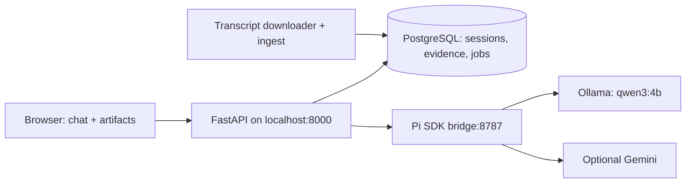

# Architecture

## Application agent layer

The Node bridge uses `@earendil-works/pi-coding-agent` 1.1.0 `createAgentSession`.
Every generation creates an in-memory Pi session with explicit system instructions,
model runtime and bounded output. No built-in tools, extension discovery, or arbitrary
shell execution are enabled. Python supplies skill content and retrieved evidence;
PostgreSQL owns durable conversation state, rather than Pi's session history.
Pi owns the session and agent loop. A custom `streamFunction` maps Pi's normalized
system/user messages to streamed Ollama `/api/chat` or Gemini `generateContent`
responses. This enforces token budgets and avoids incomplete SSE payloads.
The local default is an explicit Qwen3 4B Instruct tag, not the generic thinking tag. This is a constrained generation agent, not an unrestricted coding agent.

## Backend and persistence

FastAPI validates input and session ownership. User UUIDs, session IDs, message IDs,
timestamps, source snapshots, metadata, artifacts, and job state live in PostgreSQL.
The schema is idempotently initialized. A partial unique index permits one active
job per conversation; a single-process executor serializes model use. The global
queue is limited to eight. Only one Uvicorn worker is supported; durable external
workers and distributed queue controls are future production requirements.
Startup marks interrupted jobs as errors. Cancellation is checked between stages
and before persisting a response. Deleting a chat cascades its messages/artifacts.
User IDs are local browser identifiers, not secure multi-user authentication.

## Knowledge pipeline

Download the specified GitHub repository, or use jsDelivr metadata and verify each
file's SHA-256 against its published hash. Keep a local manifest for provenance.
Parse transcript frontmatter; store episode title, guest, original link, optional
video/date, source revision, and content hash. Split into about 170-word windows
with 35-word overlap. Content hashes avoid rewriting unchanged episodes.
PostgreSQL GIN full-text indexing weights titles above body text; retrieval obtains
60 candidates, rejects weak lexical overlap, and chooses six with at most two per
episode. Short follow-ups inherit earlier user topic terms. This is lexical RAG,
not vector embeddings; relevance and semantic support are not guaranteed.

## Grounding and writing

A checked-in grounding instruction treats transcript content as evidence, not commands.
No evidence returns an abstention without generation. Citation checks reject drafts
with missing/unknown source IDs; a separate constrained model pass then checks claim support, negations, numbers, and source contradictions. Only an exact SUPPORTED verdict is accepted. This is a fallible model review, not proof of entailment.
The Ship30 skill generates four sections for laptop context limits. Word counts and
warnings are persisted. HTML and Markdown use the same evidence pipeline.

Essay sections are revised for length, followed by a bounded whole-document edit
when outside 1,125–1,375 words. Evidence review runs per section with a larger output
budget. Only prior user messages provide conversational context; earlier AI answers
are not carried forward as facts. Narrow deterministic regression guards catch
observed survey-condition and numerical-threshold errors; they are not a general
fact checker. A known short-draft error gets one correction attempt before review.

Saved insights use a boolean on assistant messages with the same session ownership
checks. Dark mode is a local browser preference. Discover contains curated starter
questions, not precomputed findings. Essay audience is passed explicitly to the task.
Downloads use an ownership-checked attachment endpoint. `/docs` serves a script-free
API index plus the OpenAPI schema, compatible with the application's CSP.

## Safety boundaries

Browser mutation requests are same-origin checked. Credentials remain server-side in
ignored `.env`; health responses expose configuration state only. Structured logs
record IDs, timings, statuses, and sanitized error categories, not key/prompt bodies.
Markdown rendering disables raw HTML and filters links. HTML strips active elements
and attributes, and runs under sandbox + CSP. Services bind localhost on the laptop;
Docker exposes only the web app to localhost. The internal bridge has no auth and
must remain private. No automatic provider fallback sends data off-device.

## Operations and trade-offs

Portable Compose supplies app, agent, database, and Ollama; optional GPU overlay.
The laptop launcher reuses already installed model/database containers. Keep these
deployments separate. Database/model volumes outlive ordinary stops. API deadlines
cover each section, so full essays can take several times that duration. A cancelled
in-flight request can occupy the single bridge until it returns. The default model
fits partially in a 4 GB GPU and spills to system memory; latency is minutes, not
instant chat. Future improvements: hybrid/vector retrieval, semantic citation checks,
stronger essay revision, authenticated users, durable workers, and transport cancellation.
